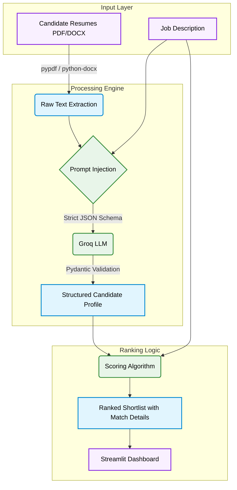

# AI Resume Screener

An LLM-powered pipeline that parses resumes and job descriptions into structured data, then ranks candidates by fit.

> **Live Deployments:**
> * **Interactive Streamlit App:** [screen-resumes-ai.streamlit.app](https://screen-resumes-ai.streamlit.app/)

---

## Overview

AI Resume Screener automates initial technical candidate screening by converting unstructured job descriptions and diverse candidate resumes (PDF/DOCX) into typed, validated data schemas. It evaluates candidate qualifications against role requirements, measures hard and soft skill alignment, quantifies years of relevant experience, and highlights skill gaps through an interactive Streamlit dashboard.

The engine processes resumes in concurrent batches with cryptographic hashing cache layer and resilient exponential backoff calls to Groq's high-speed inference endpoints.

---

## Architecture Overview



```
Job Description (text)              Resumes (PDF / DOCX)
        │                                    │
        ▼                                    ▼
   LLM → JobDescription schema      pypdf / python-docx → raw text
        │                                    │
        │                                    ▼
        │                          LLM → Resume schema (cached by SHA-256)
        │                                    │
        └───────────────┬────────────────────┘
                        ▼
             LLM → MatchResult schema
       (score, matching/missing skills, verdict)
                        │
                        ▼
             Ranked Shortlist (Streamlit)
```

---

## Features

| Feature | Description |
| ------- | ----------- |
| **Structured JD Parsing** | Extracts role title, required/preferred skills, minimum experience, education, and key responsibilities |
| **Multi-Resume Batching** | Concurrently screens candidate batches in PDF and DOCX formats |
| **Schema-Driven Extraction** | Resumes are parsed into typed Pydantic models regardless of formatting or section conventions |
| **Groq-Powered LLM** | Sub-second structured JSON extraction via Groq inference |
| **Resilient Retry with Backoff** | API requests automatically retry with exponential backoff on rate limits |
| **Content-Addressable Caching** | Resumes are cached by file hash to eliminate duplicate extraction on subsequent job runs |
| **Per-File Error Isolation** | Corrupted or image-only documents are flagged and skipped without failing the batch |
| **Ranked Shortlist Dashboard** | Interactive Streamlit interface sorted by match percentage with missing skills highlighted |

---

## Technology Stack

| Component | Technology |
| --------- | ---------- |
| User Interface | Streamlit |
| Inference Engine | Groq API |
| Data Validation | Pydantic |
| Document Extraction | pypdf, python-docx |
| Packaging & Tools | pip, setuptools, ruff, pytest |
| Containerization | Docker |

---

## Project Structure

```
AI-Resume-Screener/
├── app.py              # Streamlit UI dashboard
├── pipeline.py          # Batch screening pipeline, error isolation, and caching
├── parsing.py           # Job description and resume parsing into Pydantic models
├── scorer.py            # Candidate vs. role alignment scoring
├── llm_client.py        # Groq client wrapper with exponential backoff
├── file_readers.py      # PDF and DOCX text extraction utilities
├── models.py            # Strict Pydantic schemas
├── tests/               # Automated test suite
├── Dockerfile           # Multi-stage container build
├── requirements.txt     # Python dependencies
└── README.md
```

---

## Setup and Installation

### Prerequisites

- Python 3.11+
- A [Groq API key](https://console.groq.com/keys)

### 1. Clone the repository

```bash
git clone https://github.com/Shashank17singh/AI-Resume-Screener.git
cd AI-Resume-Screener
```

### 2. Install dependencies

```bash
pip install -e .
```

### 3. Configure environment variables

```bash
cp .env.example .env
# Edit .env and supply your API key:
# GROQ_API_KEY=your_api_key_here
```

### 4. Run the application

```bash
streamlit run app.py
```

---

## Running the Tests

Run the test suite using pytest:

```bash
pytest
```

Run static linting with ruff:

```bash
ruff check .
```

---

## Deployment

The application includes a production Dockerfile configured to run as a non-root user:

```bash
docker build -t ai-resume-screener .
docker run -p 8501:8501 -e GROQ_API_KEY=your_key ai-resume-screener
```

Live deployment is hosted on Streamlit Community Cloud at [screen-resumes-ai.streamlit.app](https://screen-resumes-ai.streamlit.app/).

---

## Known Limitations

- Semantic matching scores incorporate LLM qualitative judgment and may exhibit slight variance across identical prompts; deterministic temperature parameters are enforced to minimize spread.
- Scanned or rasterized PDF files lacking an embedded text layer require external OCR preprocessing before ingestion.

---

## License

This project is licensed under the MIT License. See [LICENSE](LICENSE) for details.
